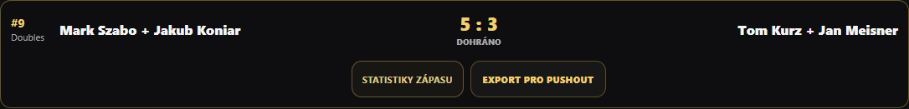
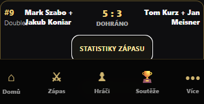

# Federal Cup 2026 #9 – chybějící propojení dokončeného Doubles

Zadavatel: Dominik. Diagnostika: 24. 10. 2026. Produkce zůstává **v4.51.95 RC** / `a12b69d600c3585fc02b79f96f02c63564334c6e`. Žádné nasazení ani produkční zápisy.

## Skutečný záznam

Podklad: uživatelem dodaný `BC_Rybarna_Scoreboard_Backup_2026-10-24 (1).json`, 30 113 405 bajtů, SHA256 `0aa18c9b610709025150ef55fd6fd177f1972612d72703635cbdd74e8b52f7eb`. Export obsahuje 180 zápasů; původní soubor nebyl změněn ani přidán do repozitáře.

| Pole | Skutečná hodnota |
|---|---|
| matchId | `3d4c35e6-e336-49d5-a9b3-9955cec59c3d` |
| startedAt | `2026-10-24T15:54:09.777Z` = 17:54:09 CEST |
| endedAt | `2026-10-24T16:27:05.963Z` = 18:27:05 CEST |
| Rozdíl časů | 32:56,186 |
| status / discipline / doublesMode | `complete` / `9-ball` / `true` |
| scores | `[5,3]` |
| Dvojice | Mark Szabo + Jakub Koniar / Tom Kurz + Jan Meisner |
| federalCupLink | **Pole zcela chybí**, není chybný rok ani jiné fixtureNo |
| federalEvidence | Pole chybí |
| detailedPlay.records | 46 záznamů, zachovány i události a undo snapshoty |
| nineBallBreakRule | `none` |

Identifikace využívá jednoznačné ID, oba přesné časy, výsledek, délku a režim; nejde o automatické přiřazení podle jmen. Export neobsahuje druhý záznam se stejným ID ani žádný záznam s vazbou na 2026/#9. Společný season reader u současných propojených zápasů nehlásí duplicity.

## Doložená příčina a hranice závěru

`federalCalculateSeason` i `completedMatch` vyžadují ročník a číslo v `federalCupLink`, dokončení a přijatelný stav. Výsledky umějí zobrazit běžný dokončený Doubles bez této vazby, ale Federal Cup jej správně nepřebírá podle jmen či pořadí. V exportu není samostatné pole matchId u nominace #9: `federalCup2026.lineups[9]` uchovává participant ID sestavy, vazba na výsledek je na zápasu.

`fc26StartFixture` připravuje pending link se zmrazenými účastníky a start jej kopíruje do zápasu; zároveň vynucuje `kitchen` a vytváří `federalEvidence.fromStart`. Ostatní dnešní Doubles #2/#4/#7 všechny tyto údaje mají. Zkoumaný zápas nemá ani jednu z těchto tří charakteristik a používá běžné profilové player ID místo FC participant ID. To **odpovídá založení jako běžný Doubles**. Není to důkaz konkrétního kliknutí uživatele; export nedokládá historii navigace před startem. Nelze z něj rozhodnout, zda někdo zvolil běžný zápas, opustil přípravu, obnovil stránku před startem nebo nastala jiná událost.

`persistFinishedMatch` klonuje celý zápas, `saveSecureMatch` klonuje celý objekt a zapisuje `/matches/{id}`; nemažou federalCupLink. `loadSecureMatches` načítá všechny objekty a vazbu zachovává. Na aktuálním HTML standardní Doubles projde založením z FC, dokončením 5:3, skutečným secure PUT/GET v mocku a browser reloadem bez ztráty vazby, včetně týmového výsledku a zdroje reportu. **Chyba ukládání nebo ztráta vazby cloudovou serializací nebyla prokázána.** Produkční cloudová relace nebyla dostupná; tvrzení o konkrétním obsahu vycházejí z exportu, nikoli z živého GET.

## Konkrétní návrh opravy ke schválení

Pouze u uvedeného matchId přidat **jediné pole `federalCupLink`**:

```json
{"year":2026,"fixtureNo":9,"block":2,"type":"doubles"}
```

Úplný návrh tohoto pole navíc obsahuje jména reprezentací, snapshot soupisek a aktuální nominaci #9 ze stejného exportu, v aplikačním formátu. Nominace není vydávána za prokázaný snapshot okamžiku založení; její doplnění je součástí schvalované nápravy:

Přesný payload, kontrolní otisky a rollback: [federal-fixture-9-link-proposal.json](federal-fixture-9-link-proposal.json). Neobsahuje přihlašovací údaje ani úplný zápas.

| Strana / pozice | Uložené profilové ID (nemění se) | Navržené FC participant ID |
|---|---|---|
| SK / Mark | `efbf5977-f3ea-4c43-a2e6-94cef082228e` | `fc-ef1400d4-fcb4-4926-985e-1e8d2a823f14` |
| SK / Jakub | `a94f12a3-4c68-46eb-a2e1-9d99db0e072b` | `fc-b43ebda0-4628-4217-8b5f-cdf1747038e2` |
| CZ / Tom | `df600b07-1899-401c-91bd-962717e3a050` | `fc-35818099-c4c1-4e03-8165-4b1bd5f7fe94` |
| CZ / Jan | `a702701b-157d-4b16-ac04-0bd366e9149e` | `fc-d37a2dab-8117-48fd-bd8f-e237f49e9803` |

Nemění se ID zápasu, skóre, hráči, teamPlayerIds, strky, události, souhrnné statistiky, rozstřelová pravidla ani jiná uložená pole. Nepřidává se `fromStart`, nevyrábějí se racky. Existující neúplnost některých metrik tak zůstane pravdivě označena interně (`legacy_coverage` / `legacy_record`). Následná oprava nezaručuje doplnění nedoložených rozstřelových metrik.

Offline nástroj `scripts/plan-federal-fixture-9-link.cjs` pouze vytvoří návrh, soukromou kopii původního zápasu a upravenou kopii v novém adresáři. Nemá síťový kód ani produkční režim. Vyžaduje přesný SHA exportu, ID, časy, skóre, profilová ID, nominaci; odmítá duplicitní nebo již propojený zápas. Lokálně připraveno v `output/fixture-9-link-review/`: `proposal.json`, `before-match.private.json`, `after-match.private.json`. Soukromé úplné zápasy se necommitují.

### Bezpečný postup až po výslovném schválení

1. Oprávněně načíst čerstvý celý `/matches/{matchId}` s ETag a aktuální konfiguraci / ostatní vazby. Při jakékoli nové vazbě, duplicitě #9, změně nominace nebo rozdílu proti schválenému záznamu zastavit a předložit nový návrh.
2. Uchovat čerstvou úplnou zálohu objektu a ETag lokálně. Porovnávat celé objekty, nikoli jen jména a skóre. Neukládat přihlašovací tokeny do evidence.
3. Podmíněný PUT na stejný matchId s `If-Match` čerstvého ETag: celý právě načtený objekt plus schválené pole federalCupLink. Při HTTP 412 zastavit; žádný bezpodmínečný opakovaný zápis. Neměnit celý appData, soupisky ani jiné zápasy.
4. Znovu načíst zápas a porovnat, že jediný věcný rozdíl je vazba. Obnovit FC a zkontrolovat #9 5:3, týmové skóre a reportové zdroje.
5. Návrat: po novém GET/ETag a kontrole absence následných úprav podmíněně odstranit pouze přidaný federalCupLink (nevracet slepě celou starou zálohu). Jiná pole i pozdější legitimní změny musejí zůstat zachovány. Při konfliktu zastavit. Soubor návrhu obsahuje rollback `{ "federalCupLink": null }` jako popis změny, ne jako automatický příkaz.

ETag jednoho zápasu neřeší atomicky současné propojení jiného zápasu s #9. Před zápisem je proto nutná kontrola ostatních vazeb a klid na administrátorských úpravách; tento diagnostický PR nezavádí databázový zámek ani nová Firebase oprávnění.

## Ověření

- Nad skutečným exportem před návrhem: 8 propojených výsledků, **Slovensko 6:2 Česko**, #9 čeká, žádné duplicity.
- Nad paměťovou kopií po doplnění pouze vazby: 9 výsledků, **Slovensko 7:2 Česko**, #9 5:3. Výhry Marka/Jakuba +1, prohry Toma/Jana +1; Doubles výkon zůstává dvojici, ne osobám. Herní metriky jsou přesně shodné před/po.
- Browser, všechny požadavky zachyceny: skutečný záznam #9 před/po, secure mock uložení/GET/reload, desktop/mobil otevření A1 na správné ID, zachování všech ostatních polí a úspěšný rollback. Nový Doubles z rozpisu rovněž zachovává vazbu.
- Cílené výpočetní/integrační/reportové Node testy **65/65 PASS**, včetně původního exportu a jeho nezměněného SHA.
- Celá Node sada **210 PASS / 2 FAIL / 1 SKIP (213)**: pouze dlouhodobá `preview-match-reload-recovery.test.cjs:50,106`. Skip je volitelný test soukromého exportu bez environment cesty; s dodaným exportem samostatně PASS. CI není plně zelené.
- Aplikační HTML/assety/výpočty neměněny, verze se nezvyšuje. Žádný produkční zápis, merge ani deployment.

Připraveno v [draft PR #34](https://github.com/bcrybarna-oss/BC-Rybarna-Scoreboard/pull/34), testovaný commit `8890f24cf13f1ee0033e04609efdddd887ceff61`. [GitHub CI 40118428244](https://github.com/bcrybarna-oss/BC-Rybarna-Scoreboard/actions/runs/40118428244): Release version and revision **success**, Node **210/213 PASS, 2 FAIL, 1 SKIP**; log potvrzuje výhradně `preview-match-reload-recovery.test.cjs:50,106`. Testy i produkční HTML jsou proti main v těchto dvou příčinách nezměněné. Následný zápis výsledku CI mění pouze dokumentaci.

Screenshoty jsou **izolovaný návrh opravy**, nikoli již opravená produkce:



