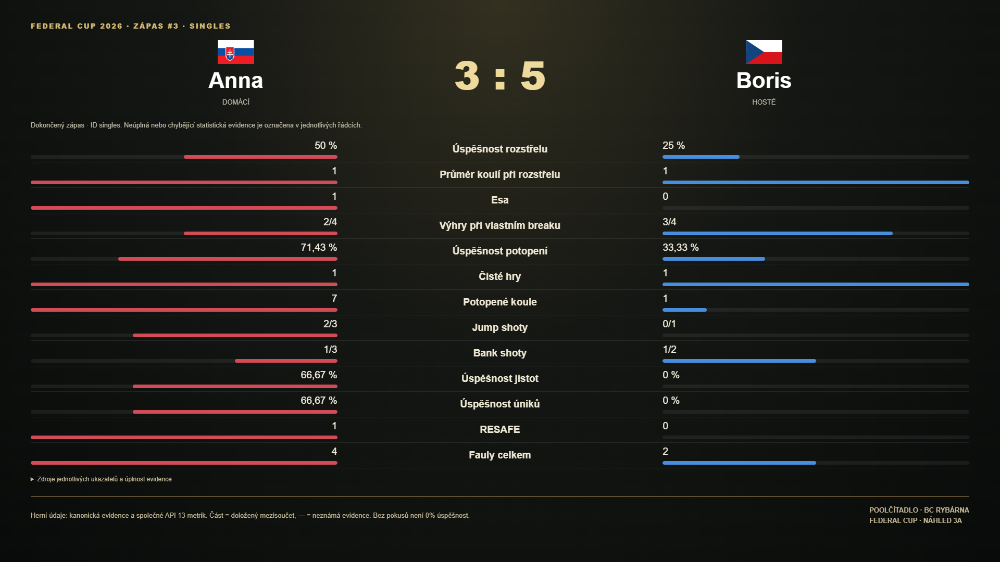
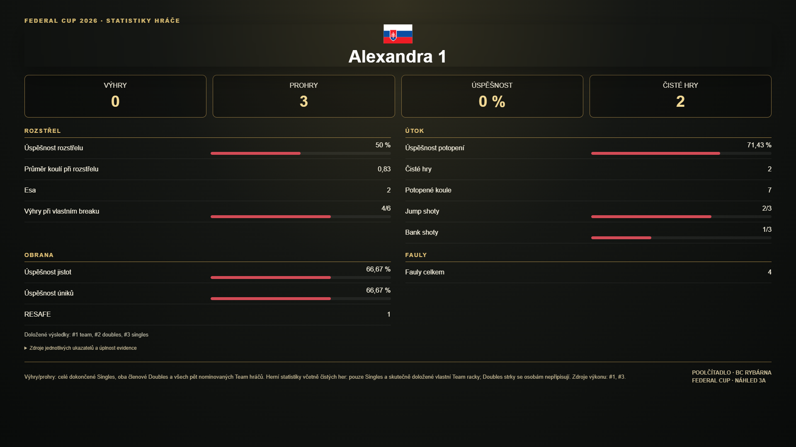
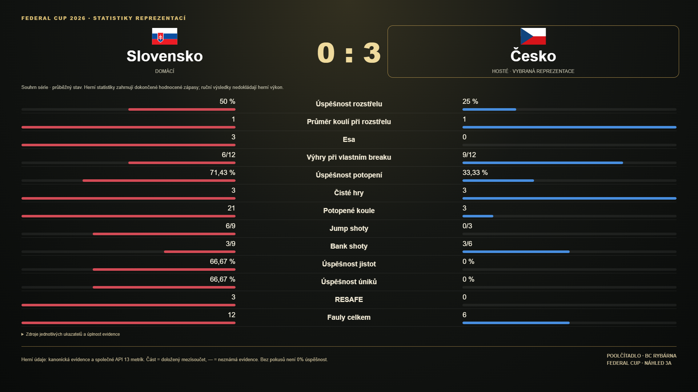

# Federal Cup – funkční reporty, etapa 3A

Zadavatel Dominik, 22. 10. 2026. Návrh před implementací: aktuální konfigurace nemá autoritativní údaj hostitele. Přidáváme `reportHost: 'SK' | 'CZ'` do konfigurace ročníku. Pro známý ročník 2026 je explicitní výchozí hodnota **SK**, podle zadání, nikoli odvozená z pole nebo jména. Jiný ročník bez výslovného nastavení nemá automatického hostitele a report vysvětlí nedostupnost. Nastavení se při čtení nepersistuje; změny konfigurace nadále používají existující admin/CAS cestu. Nezavádíme editor dalších ročníků.

Vnitřní výpočetní strany zůstávají 0=SK, 1=CZ. Report řadí pouze prezentaci podle reportHost. SK vždy používá červenou, CZ modrou bez ohledu na pozici. Případný budoucí opačný hostitel se proto neřeší prohozením historických statistik.

Výhry/prohry jsou nový, oddělený čtecí součet výsledků celých dokončených zápasů. Výběr zdrojů a deduplikaci fixture přebírá z `federalCalculateSeason().fixtures`. Singles počítá jednoho, Doubles oba členy stabilního lineup snapshotu; Team všech pět různých nominovaných osob z rosterParticipants, právě jednou za zápas. Neurčitý, konfliktní či chybějící snapshot se nepřipojuje podle jména ani dnešní soupisky. Ruční Team skóre bez historického snapshotu přispívá reprezentacím, nikoli smyšleným osobám. Případný budoucí formát ručního výsledku s doloženým rosterParticipants umí čtečka použít, ale tato etapa nemění producenta ručních výsledků a nedoplňuje snapshoty zpětně. Úspěšnost je wins/(wins+losses)*100, žádné dokončené zápasy znamenají —. Čisté hry a dalších 12 herních metrik se nadále čtou pouze z existujícího API; Doubles výkon se osobám nerozděluje.

Všechny nové vstupy a reportový dialog jsou uvnitř screen-federal-cup-2026. Běžná historie, počítadla, profily, liga, turnaje a jejich exporty se nemění. Cílové plátno náhledu 1920×1080; mobil používá čitelný vertikální obsah. Etapa 3A neobsahuje PNG/PDF ani finální grafiku 3B. Otevření, přepnutí a zavření pouze čte místní data, bez Firebase nebo zápisu do úložiště.

## Stav a ověřené hranice kandidáta v4.51.90 RC

Větev feature/federal-reports-stage-3a vychází z main f6c3e0f6ca61f6ad10ead50dc5a9b38e72f18601. Připraveno k revizi, neslučovat a nenasazovat. Produkce zůstává v4.51.89 RC. Oba reporty porovnání používají jednu šablonu A (zápas / roční reprezentace A2), individuální report šablonu B. Všechny nové HTML vstupy i dialog jsou potomky screen-federal-cup-2026, funkce otevření navíc kontroluje aktivní sekci. Dialog má návrat fokusu, zavření i Escape; při odchodu z Federal Cupu se zavře. Starý detail zápasu a ostatní exporty zůstávají.

Výběr zdrojů: nejnovější dokončený zápas podle endedAt, při shodě deterministicky ID, shodný fixture či match ID se nesčítá dvakrát. Detail má prioritu před ručním Team skóre. Výsledky i výkony reportů používají stejnou vybranou sadu; po doloženém dosažení 11 výher se další fixture nehodnotí. Při neplatném výsledku není přesný stav série prokázán a zůstane označený mezisoučet. Rozehrané/playing/active/incomplete záznamy se neprezentují jako konečný zápasový report. Jména v zápasovém reportu mají přednostně historický lineup snapshot, u Doubles oba členy, nikoli dnešní profilové jméno. Tlačítko předává ID + fixture, nikoli index či jméno; staré ID nahrazené novým záznamem otevře vysvětlení, nikoli cizí detail.

Výsledkové karty zahrnují jen skutečné výhry/prohry z validního skóre a validních snapshotů (1 Singles, 2 Doubles, 5 Team osob). Chybějící či konfliktní nominace přidává neúplnost pro reprezentaci, nikoli domnělé výsledky dnešním hráčům. Známé mezisoučty zůstanou; částečná úspěšnost se nevydává za oficiální procento. Osobní herní výkon čte nezměněné federalCalculateSeason.individuals: Singles + skutečné Team racky, bez rozdělení Doubles. Osoba bez doloženého herního výkonu má —, i když má prokázaný výsledek týmového zápasu. Současné čtyři nové výsledkové karty nijak nemění původní API 13 metrik.

Vykreslení: complete procenta/poměry mají odpovídající sloupec, 0/0 text „bez pokusů“. Partial ukazuje „Doloženo n/d (část)“ bez sloupce nebo oficiálního procenta; unknown —. Šablona A normalizuje pouze úplné počty/průměry vůči větší doložené hodnotě řádku. Šablona B ukazuje počty/průměry pouze číslem. Rozbalovací vysvětlení obsahuje zdroj všech 13 údajů a patička odděluje výsledky celých zápasů od osobních strků. Označení reprezentace ze vstupního tlačítka je pouze obrys hlavičky, žádné určování vítěze statistik.

Testy: 10 nových čistých testů datových čteček a browser nad aktuálním index.html. Pokrytí 21 zápasových tlačítek, 10 hráčských, 2 týmová; Singles/Doubles/Team, pět nominovaných osob a obě strany, duplicitní fixture a ID, rok, neplatné výsledky, historické nominace, čtyři karty, všech 13 metrik, zachování původních výpočtů, barvy/opačný hostitel, partial/unknown/0/0, chybějící ID, dlouhá jména včetně escapování HTML, přepínání, focus/Escape, mobil a nepřítomnost vstupů v ostatních sekcích. Otevření reportů: data i localStorage identické, 0 fetch, 0 zápisů, 0 JS chyb. Node 179/181, jen dvě známá nezměněná selhání preview-match-reload-recovery.test.cjs v test-modular (50/106); CI není plně zelené. Release gate proti čerstvému origin/main f6c3e0f a diff --check prošly. GitHub CI se doplní po vytvoření PR.

Zbývající hranice: ruční Team výsledky bez nominací nelze připsat osobám; neprokazatelné identity či historie se neopravují podle jmen. Rozehrané zápasy zatím nemají živý report. Přehled spravuje ročník 2026; podpora budoucího opačného hostitele je v datové/přezentační vrstvě, nikoli nový editor ročníků. Fyzické telefony, produkční Auth/Rules a zátěž nejsou ověřeny. Grafika je funkční náhled, finální vzhled a PNG/PDF export jsou až etapa 3B.

## Screenshoty skutečných náhledů z izolovaného browseru

Syntetická data, žádné produkční zápisy. Každý obrázek má 1920 × 1080 px. Jde o testovací screenshoty, nikoli implementaci produktového PNG exportu.

